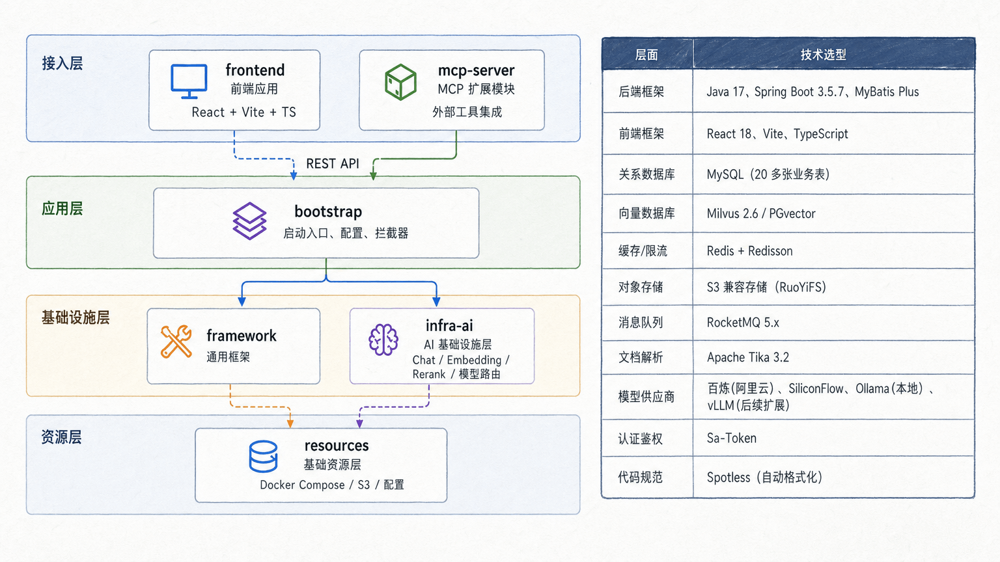
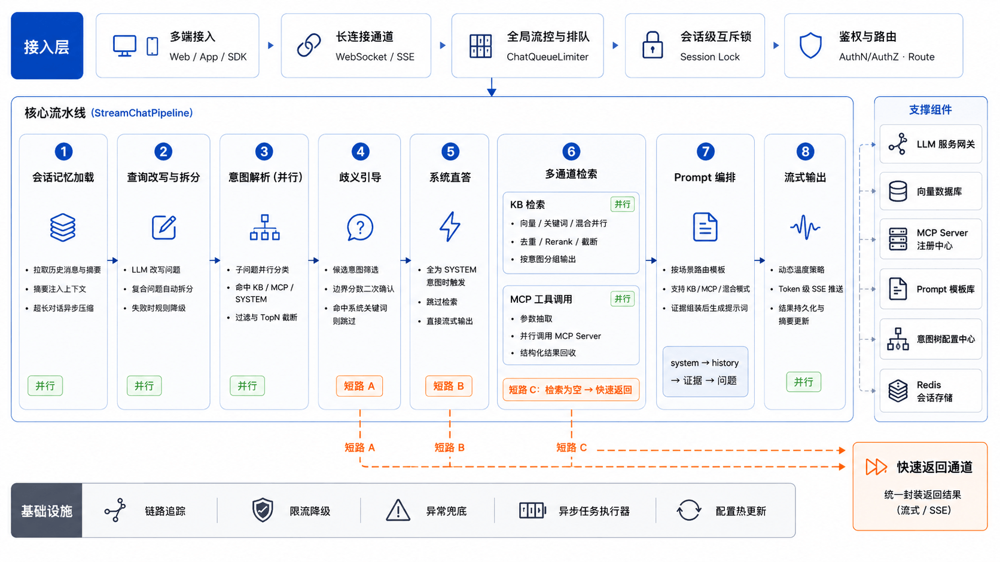
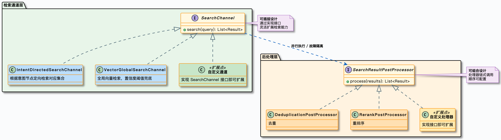
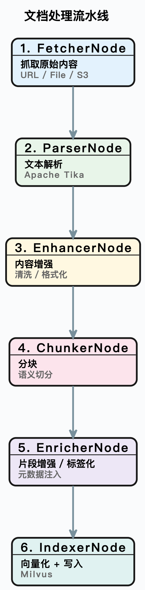

# AskFlow

一个基于 **Ragent** 二次开发的企业级 RAG 智能体平台，覆盖「文档入库 → 检索召回 → 意图识别 → 流式回答」的完整链路。

> 本项目源自开源项目 [Ragent](https://github.com/nageoffer/ragent)（作者：拿个 offer 社群），在其基础上完成了工程落地层面的调整与配置抽取。核心架构与设计思路归原作者所有，使用前请遵守原项目的 Apache-2.0 协议。
> 
> 命名说明：代码内的包名、服务名与接口前缀已改为 `askflow`（`com.askflow`、`askflow-service`、`/api/askflow`），阅读源码时请以代码为准。

## 项目定位

Ragent 解决的问题是：**让 Java 技术栈的团队能在企业内部真正跑起来一套 RAG 系统**，而不是停留在调接口的 Demo 阶段。

AskFlow 延续这个定位，面向企业内网的知识问答场景：

- **知识在哪**：制度文档、IT 支持手册、财务开票信息、业务线规范等分散在 PDF / Word / Markdown 里，统一入库后可被语义检索。
- **谁来回答**：用户用自然语言提问，系统先判断意图（查知识库 / 调业务工具 / 闲聊），再决定检索路径，最后流式输出答案。
- **怎么保证可用**：多路检索兜底召回率、模型多候选路由 + 熔断降级兜底稳定性、全链路 Trace 兜底可排查。

## 主要用途

| 场景      | 说明                                |
|:------- |:--------------------------------- |
| 企业知识库问答 | 文档上传后自动切分、向量化、入库，支持按知识库隔离检索       |
| 多轮对话    | 会话记忆滑动窗口 + 自动摘要压缩，支持深度思考模式        |
| 意图路由    | 树形意图体系，置信度不足时主动澄清，避免答非所问          |
| 工具调用    | 通过 MCP 协议接入外部业务系统，非知识类问题自动提参调用    |
| 知识运营    | 管理后台完成知识库、文档、分块、入库流水线的日常维护        |
| 效果与排障   | 全链路 Trace 记录每个节点的耗时、入参出参，便于定位效果问题 |

## 技术栈与模块

| 层次    | 技术                                                     |
|:----- |:------------------------------------------------------ |
| 后端    | Java 17、Spring Boot 3.5、MyBatis-Plus、Sa-Token、Redisson |
| 存储    | PostgreSQL + pgvector（默认向量库）、Redis、RocketMQ、S3 兼容对象存储  |
| 可选向量库 | Milvus 2.6（`rag.vector.type` 切换为 `milvus`）             |
| 前端    | React 18、TypeScript、Vite、Tailwind CSS                  |
| 模型接入  | 阿里云百炼、硅基流动、AIHubMix、Ollama（本地）                         |

后端按职责拆为四个 Maven 模块：

```
askflow
├── framework      通用基础设施：统一响应体、异常体系、幂等、上下文透传、SSE 封装
├── infra-ai       模型接入层：屏蔽不同供应商的 Chat / Embedding / Rerank 差异
├── bootstrap      业务层：RAG 链路、知识库、入库流水线、管理后台、认证鉴权
└── mcp-server     MCP 工具服务（默认 9099 端口）
```



分层的实际意义：换模型供应商不用改业务代码，改业务逻辑不动基础设施。

## 核心链路

一次用户提问，从进入服务到拿到答案，走的是下面这条主链路。图中只画主干，实际代码里还叠加了限流排队、意图澄清、多路检索与后处理等分支。



检索环节采用多通道并行 + 后处理流水线的设计：每个通道独立执行、互不影响，由线程池并行调度；去重与 Rerank 按优先级串联，逐步收敛候选集。当意图置信度低于阈值（默认 0.6）时，会额外触发全局向量检索兜底召回，避免意图识别不准导致漏检。



文档入库则是一条基于节点编排的 Pipeline：节点配置存放在数据库中，支持条件执行与输出链式传递，任务与节点各自记录执行日志，出错能定位到具体一步。



## 环境变量清单

所有敏感配置都通过占位符从外部注入，源码中不保留真实密钥。当前生效的变量如下：

| 变量名                   | 必填  | 用途                                                 | 缺失后果                |
|:--------------------- |:---:|:-------------------------------------------------- |:------------------- |
| `POSTGRES_PASSWORD`   | 是   | PostgreSQL 用户 `serveruser` 的密码                     | 数据源初始化失败，应用无法启动     |
| `REDIS_PASSWORD`      | 是   | Redis 连接密码                                         | Redis 连接失败，缓存与限流不可用 |
| `BAILIAN_API_KEY`     | 是   | 阿里云百炼 DashScope，默认对话模型 `qwen-plus` + Rerank        | 对话与重排序调用返回 401      |
| `SILICONFLOW_API_KEY` | 是   | 硅基流动，默认 Embedding 模型 `Qwen3-Embedding-8B`          | 文档向量化与检索失败          |
| `AIHUBMIX_API_KEY`    | 否   | AIHubMix，候选模型 `gpt-5.4` 与 `text-embedding-3-large` | 仅在路由到该候选时报错         |
| `RUSTFS_ACCESS_KEY`   | 是   | 对象存储 Access Key（文档原件存储）                            | 文档上传、预览失败           |
| `RUSTFS_SECRET_KEY`   | 是   | 对象存储 Secret Key                                    | 同上                  |

补充说明：

- **变量与配置项的对应关系**统一写在 `bootstrap/src/main/resources/application.yaml` 中，形式为 `${POSTGRES_PASSWORD:}`。冒号后的默认值为空，表示未提供时不阻断启动，但依赖该配置的功能会不可用（例如缺 `BAILIAN_API_KEY` 时对话直接报错）。
- **`unique-name`（可选）**：不是环境变量，而是启动时传入的普通参数（如 `--unique-name=dev-a`），用于在同机部署多实例时隔离服务名与 RocketMQ 生产者组。个人开发可忽略。

### 配置方式

三种方式任选其一，优先级从高到低：命令行参数 → 环境变量 → `application-local.yaml`。

#### 方式一：`application-local.yaml`（本地开发推荐）

项目根目录的 `application-local.yaml` 会被自动加载（`spring.config.import: optional:file:./application-local.yaml`），且已被 `.gitignore` 忽略，不会误提交。文件结构必须与 `application.yaml` 一致，只写需要覆盖的项：

```yaml
spring:
  datasource:
    # 对应环境变量 POSTGRES_PASSWORD
    password: your_pg_password
  data:
    redis:
      # 对应环境变量 REDIS_PASSWORD
      password: your_redis_password

ai:
  providers:
    bailian:
      # 对应环境变量 BAILIAN_API_KEY
      api-key: sk-xxxxxxxxxxxxxxxxxxxxxxxx
    siliconflow:
      # 对应环境变量 SILICONFLOW_API_KEY
      api-key: sk-xxxxxxxxxxxxxxxxxxxxxxxx
    # aihubmix 需要时再填，对应 AIHUBMIX_API_KEY
    # aihubmix:
    #   api-key: sk-xxxxxxxxxxxxxxxxxxxxxxxx

rustfs:
  # 对应 RUSTFS_ACCESS_KEY / RUSTFS_SECRET_KEY
  # 必须与 docker compose 中 rustfs 的 --access-key / --secret-key 保持一致
  access-key-id: rustfsadmin
  secret-access-key: rustfsadmin
```

#### 方式二：环境变量（生产环境推荐）

```bash
# Linux / macOS
export POSTGRES_PASSWORD='your_pg_password'
export REDIS_PASSWORD='your_redis_password'
export BAILIAN_API_KEY='sk-xxxxxxxx'
export SILICONFLOW_API_KEY='sk-xxxxxxxx'
export RUSTFS_ACCESS_KEY='rustfsadmin'
export RUSTFS_SECRET_KEY='rustfsadmin'
```

```powershell
# Windows PowerShell
$env:POSTGRES_PASSWORD = "your_pg_password"
$env:REDIS_PASSWORD    = "your_redis_password"
$env:BAILIAN_API_KEY   = "sk-xxxxxxxx"
$env:SILICONFLOW_API_KEY = "sk-xxxxxxxx"
$env:RUSTFS_ACCESS_KEY = "rustfsadmin"
$env:RUSTFS_SECRET_KEY = "rustfsadmin"
```

#### 方式三：IDE 启动参数

在 IDEA 的 Run Configuration → Environment variables 中逐项填入即可，等价于方式二。

### 其他常用配置（非敏感）

以下项在 `application.yaml` 中已给定默认值，按需修改：

| 配置项                      | 默认值                      | 说明                                |
|:------------------------ |:------------------------ |:--------------------------------- |
| `server.port`            | `9090`                   | 后端端口，接口前缀固定为 `/api/askflow`       |
| `rag.vector.type`        | `pg`                     | 向量库类型，可选 `pg` / `milvus`          |
| `milvus.uri`             | `http://localhost:19530` | 仅 `rag.vector.type=milvus` 时生效    |
| `rag.default.dimension`  | `1536`                   | 向量维度，必须与所选 Embedding 模型输出维度一致     |
| `ai.chat.default-model`  | `qwen-plus`              | 默认对话模型，候选列表见 `ai.chat.candidates` |
| `rag.mcp.servers[0].url` | `http://localhost:9099`  | MCP 工具服务地址                        |
| `app.demo-mode`          | `false`                  | 演示模式开关                            |

## 快速启动

### 0. 前置依赖

| 依赖      | 版本要求   | 说明               |
|:------- |:------ |:---------------- |
| JDK     | 17+    | 编译与运行            |
| Node.js | 18+    | 前端构建             |
| Docker  | 任意较新版本 | 运行中间件；也可用本机安装的实例 |

无需单独安装 Maven，仓库自带 `mvnw`（Windows 用 `mvnw.cmd`）。

### 1. 启动中间件

**PostgreSQL 与 Redis** 仓库未提供 compose 文件，可用以下命令快速起本地实例：

```bash
docker run -d --name askflow-pg \
  -p 5432:5432 \
  -e POSTGRES_PASSWORD='your_pg_password' \
  -v askflow-pg-data:/var/lib/postgresql/data \
  pgvector/pgvector:pg16

docker run -d --name askflow-redis \
  -p 6379:6379 \
  redis:7-alpine redis-server --requirepass 'your_redis_password'
```

**RocketMQ**（入库流水线依赖）：

```bash
docker compose -f resources/docker/rocketmq-stack-5.2.0.compose.yaml up -d
```

> **ARM64 机器（Apple Silicon / aarch64 服务器）请改用：**
>
> ```bash
> # 1. 注册 amd64 模拟器（裸 Linux 必需；Docker Desktop 已内置）
> #    推荐 apt 方式：binfmt 注册在重启后由 systemd-binfmt 自动恢复
> sudo apt update && sudo apt install -y qemu-user-static
> sudo systemctl restart systemd-binfmt
> ls /proc/sys/fs/binfmt_misc/ | grep qemu-x86_64        # 应能看到该条目
> docker run --rm --platform linux/amd64 alpine uname -m # 应输出 x86_64
>
> # 2. 启动
> docker compose -f resources/docker/rocketmq-stack-arm64-5.2.0.compose.yaml up -d
> ```
>
> 也可用 `sudo docker run --privileged --rm tonistiigi/binfmt --install amd64` 一步注册，但该方式写在内核 `binfmt_misc` 里、**重启后失效，需要重新执行**。
>
> 该文件给 namesrv/broker 固定了 `platform: linux/amd64`（`apache/rocketmq:5.2.0` 官方只有 amd64 单架构 manifest，只能靠 QEMU 模拟，速度略慢），而 dashboard 不固定平台、直接跑原生 arm64。若 QEMU 未注册，容器会以 `exec format error` 启动失败。`rocketmq-stack-amd-5.2.0.compose.yaml` 则是三个服务全部固定 amd64 的版本。

**对象存储 + Milvus**（同一份 compose 内包含 rustfs，即使不使用 Milvus 也需要 rustfs 来存文档原件）：

```bash
docker compose -f resources/docker/milvus-stack-2.6.6.compose.yaml up -d
```

> 内存紧张时改用 `resources/docker/lightweight/` 下的版本（已设置各容器内存上限）。若因内核版本导致 Milvus 2.6.6 启动失败，可换用 `milvus-stack-2.5.8.compose.yaml`。

### 2. 初始化数据库

数据库名固定为 `askflow`，连接用户固定为 `serveruser`（两者都能在 `application.yaml` 中改）。

```bash
# 1) 创建用户与库（用超级用户执行）
psql -h 127.0.0.1 -U postgres -c "CREATE USER serveruser WITH PASSWORD 'your_pg_password';"
psql -h 127.0.0.1 -U postgres -c "CREATE DATABASE askflow OWNER serveruser;"

# 2) 先以超级用户创建 pgvector 扩展，避免业务账号权限不足
psql -h 127.0.0.1 -U postgres -d askflow -c "CREATE EXTENSION IF NOT EXISTS vector;"

# 3) 建表 + 初始化数据
psql -h 127.0.0.1 -U serveruser -d askflow -f resources/database/schema_pg.sql
psql -h 127.0.0.1 -U serveruser -d askflow -f resources/database/init_data_pg.sql
```

初始化会写入默认管理员账号：`admin / admin`（首次登录后请及时修改）。

### 3. 填写配置

在项目根目录创建 `application-local.yaml`，内容参照上文「方式一」的模板。注意以下几点：

- `rustfs` 的账号密码要与 compose 里 `--access-key` / `--secret-key` 一致（compose 默认为 `rustfsadmin`）。
- 至少配置 `BAILIAN_API_KEY` 与 `SILICONFLOW_API_KEY`，否则对话和向量化都无法工作。

### 4. 构建并启动后端

```bash
# 构建（跳过测试以加快首次构建）
./mvnw clean package -DskipTests

# 启动
java -jar bootstrap/target/bootstrap-0.0.1-SNAPSHOT.jar
```

也可以直接用 Maven 插件启动（免打包，便于断点调试）：

```bash
./mvnw -pl bootstrap -am spring-boot:run
```

Windows 下把 `./mvnw` 换成 `mvnw.cmd`。启动成功的标志是日志中出现 Tomcat 监听 `9090` 且无异常堆栈。

### 5. 启动前端

```bash
cd frontend
npm install
npm run dev
```

开发服务器监听 `5173`，`/api` 请求已通过 Vite 代理转发到 `http://localhost:9090`（见 `frontend/vite.config.ts`），无需额外配置跨域。

### 6. 验证

验证一：后端接口是否通。登录接口能返回 `token`，说明数据库连接与鉴权链路正常；返回非 `0` 的 `code` 时，看 `message` 定位是账号错误还是依赖服务未就绪。

```bash
curl -X POST http://localhost:9090/api/askflow/auth/login \
  -H "Content-Type: application/json" \
  -d '{"username":"admin","password":"admin"}'
```

正常响应（`code` 为 `"0"` 表示成功，成功时不返回 `message`）：

```json
{
  "code": "0",
  "data": {
    "userId": "2001523723396308993",
    "role": "admin",
    "token": "xxxxxxxx-xxxx-xxxx-xxxx-xxxxxxxxxxxx",
    "avatar": "https://..."
  }
}
```

验证二：流式问答是否通。把上一步拿到的 token 填进去，SSE 会持续推送分片内容。

```bash
curl -N -G "http://localhost:9090/api/askflow/rag/v3/chat" \
  --data-urlencode "question=公司年假怎么申请" \
  -H "Authorization: <你的 token>"
```

验证三：前端是否跑通。浏览器打开 `http://localhost:5173`，用 `admin / admin` 登录，首页输入问题应能看到逐字输出的回答。

### 7.（可选）启动 MCP 工具服务

需要体验意图路由到业务工具的能力时启动，默认端口 `9099`，与 `rag.mcp.servers[0].url` 对应。

```bash
./mvnw -pl mcp-server -am spring-boot:run
```

## 端口一览

| 端口                  | 服务                                       |
|:------------------- |:---------------------------------------- |
| 9090                | 后端 API（前缀 `/api/askflow`）                |
| 9099                | MCP 工具服务                                 |
| 5173                | 前端开发服务器                                  |
| 5432 / 6379         | PostgreSQL / Redis                       |
| 9876 / 10911 / 8080 | RocketMQ NameServer / Broker / Dashboard |
| 9000 / 9001         | rustfs S3 API / 控制台                      |
| 19530 / 9091 / 8000 | Milvus / Milvus 指标 / Attu 控制台            |

## 常见问题

**应用启动报数据库连接失败**
确认 PostgreSQL 已监听 5432、库名是 `askflow`、用户 `serveruser` 存在且密码与 `POSTGRES_PASSWORD` 一致。`application.yaml` 中的连接串默认指向 `127.0.0.1:5432`。

**建表时报 `type "vector" does not exist` 或 `permission denied to create extension`**
pgvector 扩展未预创建，或当前账号不是超级用户。需先用超级用户执行 `CREATE EXTENSION vector;`，且 PostgreSQL 镜像必须自带 pgvector（用 `pgvector/pgvector` 镜像，或自行编译安装）。

**文档上传后一直停在处理中**
入库依赖 RocketMQ。检查 `docker compose` 中 NameServer（9876）与 Broker（10911）是否健康，以及 `rocketmq.name-server` 是否指向正确地址。

**文档上传报 500 / 预览地址打不开**
多为对象存储凭证不一致：`RUSTFS_ACCESS_KEY` / `RUSTFS_SECRET_KEY` 必须与 compose 中 `--access-key` / `--secret-key` 相同（默认均为 `rustfsadmin`）。

**问答返回鉴权错误或空回答**
逐个确认 `BAILIAN_API_KEY`、`SILICONFLOW_API_KEY` 是否有效。默认 Embedding 走硅基流动、对话与 Rerank 走百炼，任一缺失都会中断链路。

**检索结果为空但文档已入库**
检查 `rag.default.dimension`（默认 1536）与 Embedding 模型实际输出维度是否一致。维度不匹配时向量写入与检索都会失败。

**换 Milvus 后启动报错**
需同时修改 `rag.vector.type: milvus` 并确认 `milvus.uri` 可达；Milvus 首次启动较慢，`9091/healthz` 通过后再启动后端。

## 协议

沿用上游项目的 Apache-2.0 License，详见 [LICENSE](./LICENSE)。

## 致谢

感谢 [Ragent](https://github.com/nageoffer/ragent) 作者及社区的开源工作，本项目的架构设计、核心链路实现均建立在其基础之上。上游文档与在线体验地址见 [nageoffer.com/ragent](https://nageoffer.com/ragent)。
